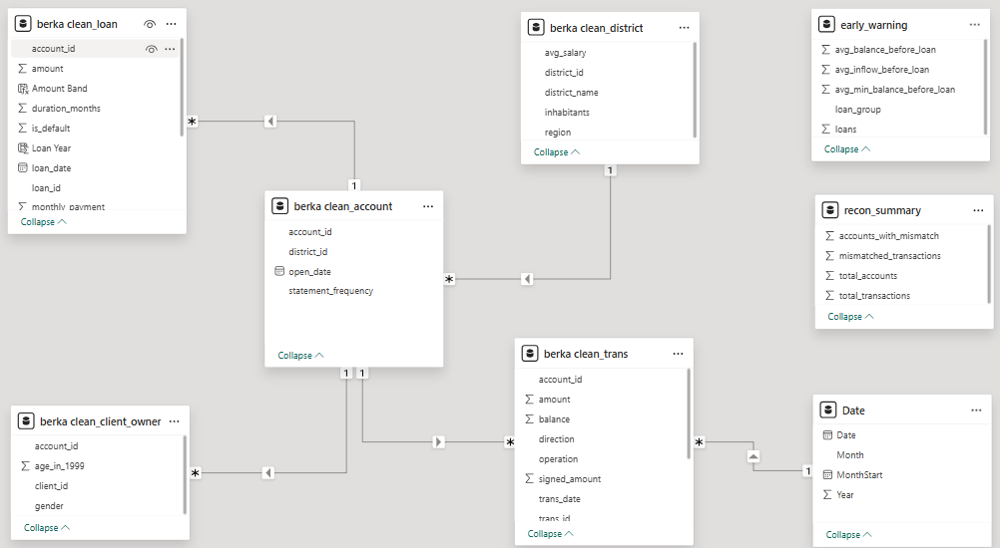
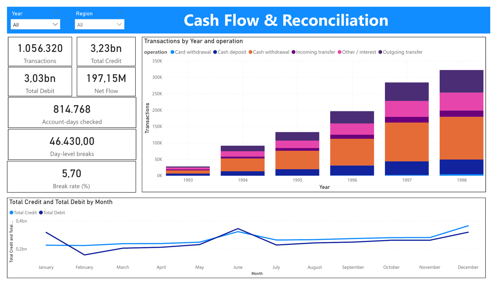
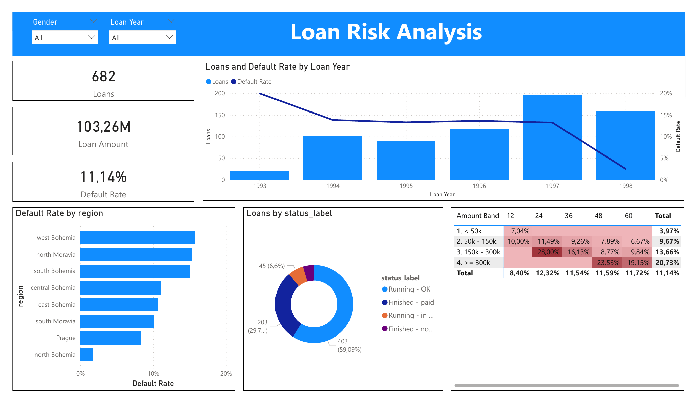

# Czech Bank SQL Analysis: Balance Reconciliation & Credit Risk

SQL portfolio project on a real, anonymized retail-banking dataset (the "Berka" dataset, PKDD'99 Discovery Challenge): **1 million+ transactions, 4,500 accounts and 682 loans** from a Czech bank, 1993–1998.

The project answers five business questions a bank's data or risk team would ask:

| # | Question | SQL techniques |
|---|----------|----------------|
| 1 | Is the data complete and consistent? | `LEFT JOIN` anti-join, `GROUP BY ... HAVING`, `UNION ALL` |
| 2 | **Does every account balance reconcile with its transactions?** | `LAG()` window function, daily aggregation, self-join |
| 3 | How does cash flow trend month by month? | `LAG()`, running `SUM() OVER`, share of total |
| 4 | **Which loans default, and are there early-warning signals?** | Multi-table `JOIN`, date-range joins, `CASE` banding |
| 5 | How can accounts be segmented? | `NTILE()`, `RANK() OVER (PARTITION BY ...)` |

## Dataset

- **Source:** Berka, P. (1999). *Guide to the Financial Data Set*, PKDD'99 Discovery Challenge. Available on Kaggle as [*The Berka Dataset*](https://www.kaggle.com/datasets/marceloventura/the-berka-dataset) and from the [CTU Relational Dataset Repository](https://relational.fel.cvut.cz/dataset/Financial).
- **Tables used:** `account`, `client`, `disp`, `trans`, `loan`, `district`.
- Raw data is **not** included in this repository; download it from the source above.

## Project structure

```
sql/
├── 00_load_data.sql              # Create database and raw tables, load the Berka files (LOAD DATA)
├── 01_clean_tables.sql           # Clean, typed, indexed tables: YYMMDD -> DATE, Czech labels -> English
├── 02_data_quality.sql           # Row counts, duplicates, orphan records, invalid dates and amounts
├── 03_balance_reconciliation.sql # Rebuild running balances and flag every break
├── 04_monthly_trends.sql         # Monthly credit/debit, MoM growth, cumulative net flow
├── 05_loan_risk.sql              # Default rates by size, duration, region, pre-loan behaviour, payment burden
└── 06_customer_segmentation.sql  # Value/activity segments, top accounts per region, owner profile
images/                           # Power BI data model and dashboard screenshots
```

## Highlights

**Balance reconciliation (03).** A first, line-level check rebuilds each balance as *previous balance + signed amount* with `LAG()`. Because same-day transactions are not reliably ordered, the final check compares each day with the previous one (closing balance = previous closing + day net amount, using `LAG()` over daily totals), which is independent of same-day ordering and does not let one break spill into later days. Daily totals are stored in `recon_daily` and results in `recon_local`, so the heavy steps run once.

**Loan risk (05).** Loans with status B (finished, not paid) or D (running, in debt) are treated as defaults. Beyond default rates by segment, the analysis compares account behaviour in the **90 days before the loan was granted** (average and minimum balance, inflows, activity) between defaulted and performing loans, and checks default rates by **monthly payment as a share of average monthly inflow**.

## Key findings

All amounts are in Czech koruna (CZK).

**1. Data quality.** Row counts match the documented dataset: 1,056,320 transactions, 4,500 accounts and 682 loans. The data-quality script also checks duplicate IDs, orphan records and transactions dated before the account was opened. 14 transactions (0.001%) have a zero or non-positive amount; they were kept and flagged rather than deleted.

**2. Balance reconciliation: getting the test right.** The reconciliation went through three iterations:

| Method | Flagged |
|---|---|
| Line-by-line, rebuilding each balance in `trans_id` order | ~531K transactions (~50%) in 4,452 accounts |
| Cumulative running total from the first transaction | 73.3% of account-days |
| **Day-to-day: closing balance = previous closing + day net** | **46,430 of 814,768 account-days (5.7%)** |

- The first method over-counts because interest and fees are posted on the **same day** and `trans_id` does not follow the real posting order within a day.
- The second method over-counts because **one early break propagates** to every later day of the account.
- The day-to-day test removes both effects. Spot checks (e.g. account 1) reconcile exactly, which confirms the loading and sign logic.
- The remaining 5.7% of account-days (in 4,432 accounts) are spread across almost all accounts, which points to a systematic pattern in specific transaction types rather than random errors. **Next step:** break the flagged days down by transaction type and `k_symbol` to isolate the cause.

> Lesson: before reporting a break, check whether the test itself relies on an assumption (ordering, opening balance) that the data does not guarantee.

**3. Cash flow.** Total credits of **3.23bn** vs debits of **3.03bn**, a net inflow of **197.15M**. Transaction volume grew roughly tenfold from 1993 to 1998 as the account base expanded. Cash withdrawals are the largest transaction type every year, while card withdrawals stay marginal, consistent with a mostly cash-based economy in the 1990s.

**4. Loan book and default risk.** 682 loans worth **103.26M**: 59.1% running and current (C), 29.8% finished and repaid (A), 6.6% running in debt (D) and 4.5% finished unpaid (B). The overall default rate (B + D) is **11.14%**.
- **Risk rises with loan size:** default rate grows from **3.97%** for loans under 50k to **9.67%** (50k–150k), **13.66%** (150k–300k) and **20.73%** for loans of 300k or more, about **5x** between the smallest and largest band.
- **Riskiest combinations:** 150k–300k over 24 months (**28.00%**) and ≥300k over 48 months (**23.53%**).
- **Duration:** 12-month loans default least (**8.40%**), 24–60 month loans sit around **11.5–12.3%**.
- **Region:** default rates range from about **15–16%** in west Bohemia, north Moravia and south Bohemia to below **2%** in north Bohemia, with Prague at roughly **8–9%**.
- **Vintage effect:** loans granted in 1998 show a very low default rate (about 2–3%) most likely because most of them are still running and have not had time to default. Comparing vintages fairly requires looking at finished loans only.

**5. Early-warning signal.** Account behaviour in the 90 days **before** the loan was granted already separates future defaulters (76 loans) from performing loans (606):

| 90 days before the loan | Defaulted | Performing | Difference |
|---|---|---|---|
| Average balance | 30,381 | 44,928 | **−32%** |
| Average minimum balance | 11,491 | 25,050 | **−54%** |
| Average inflow | 73,716 | 87,874 | −16% |

The minimum balance is the strongest signal: future defaulters run their accounts much closer to zero before borrowing.

**Recommendations.** Apply stricter affordability checks and collateral requirements to loans above 150k, especially at 24–48 months, add pre-loan balance behaviour (especially the minimum balance over the previous 90 days) as a credit-scoring input, and monitor regional default rates for the highest-risk districts.

## Dashboard

Power BI report built on the cleaned tables in a star schema (fact tables `clean_trans` and `clean_loan`, dimensions for account, district, owner and date).







## How to run (MySQL 8.0+)

1. Install [MySQL Community Server and MySQL Workbench](https://dev.mysql.com/downloads/).
2. Run `SHOW VARIABLES LIKE 'secure_file_priv';` and copy the six `.csv` files into that folder (by default `C:/ProgramData/MySQL/MySQL Server 8.0/Uploads/`).
3. Run `00_load_data.sql` (edit the path first if your folder differs). The final query shows the row count of each table.
4. Run `01_clean_tables.sql` once, then any of the analysis scripts (02–06).

All queries use MySQL 8.0 features: CTEs and window functions (`LAG`, `ROW_NUMBER`, `RANK`, `NTILE`, `SUM() OVER`).

## Author

**Nguyen Ba Hong Minh**, Data Analyst · [LinkedIn](https://www.linkedin.com/in/nguy%E1%BB%85n-b%C3%A1-h%E1%BB%93ng-minh-7754a832b/)
